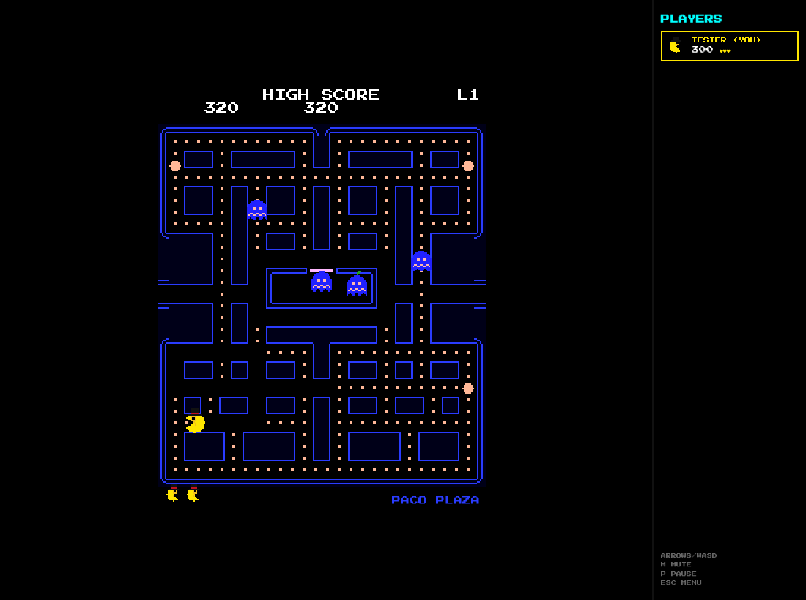

# PACO SHOWDOWN

An original, pixel-art **maze-chase game** for the browser, with **online multiplayer**. One player
is Paco. Everyone else is a ghost, sees the maze through fog of war, and tries to catch Paco.



## Features
* **Single player**: classic rules (dots, 4 power balls, ghost streaks of 200/400/800/1600…,
  3 lives) against AI ghosts with four distinct personalities.
* **Multiplayer** (2–5 players) over **WebRTC**: host a room, share the 5-letter code, and
  friends join. Paco and the ghosts are played by humans, and AI fills the empty ghost slots.
  Catching Paco is worth +1000 and makes you the next Paco. Each player has 2 lives.
* **Paco-Monster bonus**: clear the board and Paco grows to
  double size, smashes walls, and hunts the ghosts for 15 seconds with its own heavy music, crunching sounds and a screen shake on
  every smashed wall. The round ends when the time is up or all ghosts are eaten.
* **3 original mazes** (Paco Plaza, Neon Labyrinth, Pumpkin Fortress) that cycle.
* **Selectable characters**: Paco, Paco-Girl, Paco-President (top hat and monocle), Paco-Punk,
  Paco-Ninja, and Paco-Cool, plus 8 ghost skins (Count Boo, Sir Spook, Ghostbeard…). Pick them with ◀ ▶ arrows,
  and change them, along with your nickname, in the lobby until the game starts.
* **Dev options** in the main menu let you play any map or level and test mechanics instantly:
  Paco-Monster wall smashing, a level clear, power balls, invincibility, and
  more.
* **Menu music** (original chiptune loop). The ♪ button mutes everything.
* Everything is generated in code: ASCII pixel-art sprites, neon wall outlines, and a WebAudio
  chiptune synth with an original intro jingle, waka, siren, and other effects.

## Play
```bash
npm install
npm run dev          # http://localhost:5173
```
Controls: arrows or WASD (swipe or the on-screen D-pad on touch screens), **P** pause, **M**
mute, **Esc** menu.

* Multiplayer between browser tabs, no network needed: `http://localhost:5173/?net=local`
* Through the WebSocket relay instead of WebRTC: run `npm run relay`, then open `?net=ws`

## Develop
```bash
npm run check        # typecheck + unit tests + build
npm run smoke        # headless browser playthrough (after build), screenshots in ./screenshots
```
Every push to the default branch runs CI and, if it passes, publishes the build to GitHub Pages: https://lodwrot.github.io/Paco-showdown/ (Settings → Pages → Source must be "GitHub Actions").

Docs: [plan & research](docs/PLAN.md) · [rules](docs/GAME_RULES.md) · [maps](docs/MAP_FORMAT.md) ·
[networking](docs/NETWORKING.md) · [architecture](docs/ARCHITECTURE.md). For AI assistants: [CLAUDE.md](CLAUDE.md).

Paco Showdown is an original work inspired by the maze-chase genre. It contains no assets, maze
layouts, or music from any existing game.
